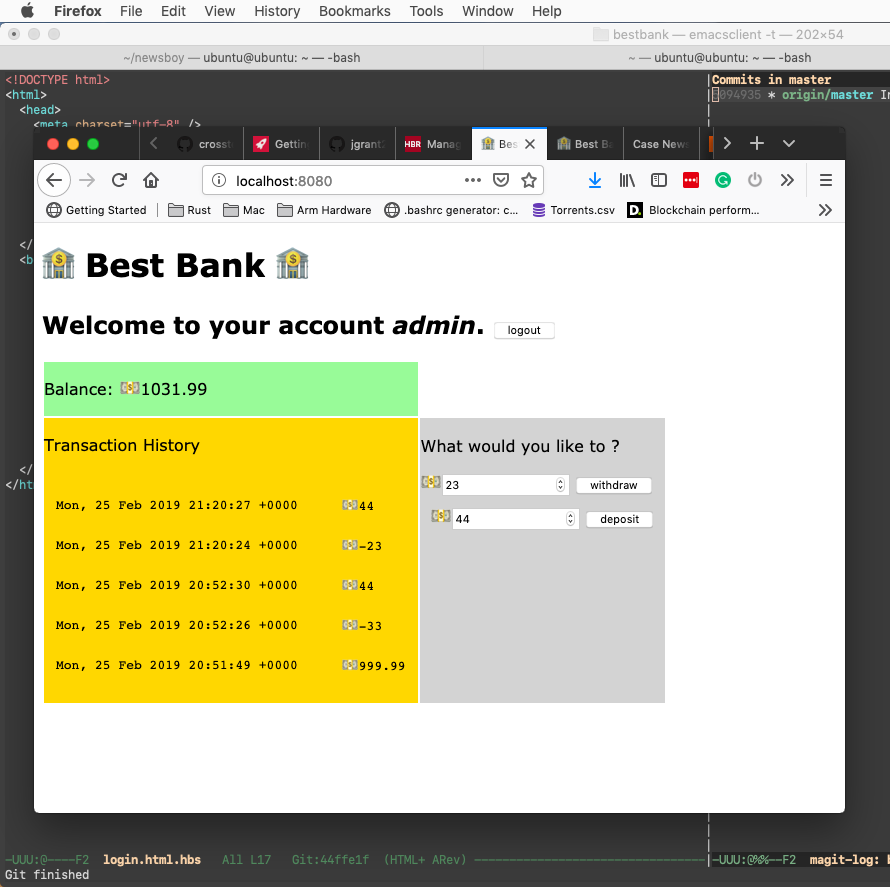

# bestbank


A small [Rocket](https://rocket.rs) 0.5 web app in [Rust](https://www.rust-lang.org)
that demonstrates:

- Login / logout with **server-side sessions**: a random token in an
  encrypted private cookie (`HttpOnly`, `SameSite=Strict`), stored hashed in
  the database with absolute and idle expiry, rotated on login, revoked on
  logout, plus "log out everywhere". Argon2id password hashes.
- Request guards, request ranking, managed state and flash messages.
- SQLite persistence via [`sqlx`](https://github.com/launchbadge/sqlx) with
  embedded migrations, with money stored as integer cents and atomic,
  overdraft-safe withdrawals.
- [MiniJinja 2](https://docs.rs/minijinja) templates (`templates/*.html.j2`
  with a shared `base` layout, autoescaped; printing a variable the handler
  didn't pass is a render error), with the account page kept up to date from
  JSON endpoints.
- Authenticated, per-user WebSocket notifications (`rocket_ws`) on the same
  port as the app.

> **This is a demo, not a real bank.** It ships with a hard-coded demo
> account. See
> [Security notes](#security-notes).

### Install Rust

Follow the [instructions](https://www.rust-lang.org/tools/install) here.

### Run the app

```
cargo run
```

Then open <http://localhost:8080>. The debug profile listens on port 8080 and
generates a throwaway secret key on each start (so sessions don't survive a
restart).

### Database

Data is stored in SQLite at `bestbank.db` in the working directory (see
`database_url` in `Rocket.toml`). Migrations in `migrations/` are compiled
into the binary and applied on startup. Delete the file to start over, or run
with a throwaway in-memory database:

```
ROCKET_DATABASE_URL=sqlite::memory: cargo run
```

### Run it behind TLS

The `release` profile listens on 8443 with TLS using the demo certificate in
`private/`. Because sessions are encrypted cookies, release mode **requires**
a secret key; Rocket refuses to start without one:

```
ROCKET_SECRET_KEY=$(openssl rand -base64 32) cargo run --release
```

Then open <https://localhost:8443>. The certificate is self-signed by the demo
CA in `private/ca_cert.pem` (generated with `private/gen_cert.sh`). Trust it or
accept the browser warning. **Never** use this certificate/key pair for
anything real.

Configuration lives in `Rocket.toml` (`[default]`, `[debug]`, `[release]`,
`[release.tls]`); any value can be overridden with `ROCKET_*` environment
variables.

### Log in / register

A demo account is seeded at startup: **admin / admin** (disable with
`seed_demo_admin = false`). New users can sign up at `/register`:

- usernames are 3-32 characters from `A-Z a-z 0-9 _ . -` and unique
  regardless of case;
- passwords must be 8-128 characters, must not be a very common password and
  must not contain the username.

Set `allow_registration = false` in `Rocket.toml` (or
`ROCKET_ALLOW_REGISTRATION=false`) to turn sign-ups off.

### Endpoints

| Method | Path                 | Auth  | Notes                                     |
|--------|----------------------|-------|-------------------------------------------|
| GET    | `/`, `/login`        | –     | Login page (with flash messages)          |
| POST   | `/login`             | –     | Form: `username`, `password`              |
| POST   | `/logout`            | –     | Deletes this session (server side)        |
| POST   | `/logout_all`        | user  | Revokes all of the user's sessions        |
| GET    | `/register`          | –     | Sign-up form                              |
| POST   | `/register`          | –     | Form: `username`, `password`, `confirm`   |
| GET    | `/user_banking`      | user  | Banking page (redirects to login if not)  |
| GET    | `/json/account_info` | user  | Balance and history, newest first         |
| POST   | `/json/deposit`      | user  | JSON `{"amount": 12.34}` + `X-CSRF-Token` |
| POST   | `/json/withdraw`     | user  | JSON `{"amount": 12.34}` + `X-CSRF-Token` |
| POST   | `/json/transfer`     | user  | JSON `{"to": "bob", "amount": 12.34}` + `X-CSRF-Token` |
| GET    | `/ws`                | user  | WebSocket: your own transaction events    |
| GET    | `/json/csrf`         | –     | Current CSRF token (for API clients)      |
| GET    | `/dump`              | admin | Users, balances, transaction counts (JSON) |
| GET    | `/static/*`          | –     | Static files (favicon, CSS, JS)           |

Amounts must be positive, have at most two decimal places and be at most
1,000,000.00 per transaction; withdrawals and transfers can't overdraw. Invalid requests get
a 4xx status with `{"success": false, "message": "..."}` (403 for a missing
or wrong CSRF token or a cross-origin request). All form POSTs need the
`csrf_token` field. Unauthenticated API
requests get `401`.

Transfers move money to another user (recipient matched case-insensitively,
not yourself). The debit and the credit are written in one `BEGIN IMMEDIATE`
transaction, so a transfer either fully happens or not at all, and concurrent
transfers can't overdraw. Each side's history entry has a `kind`
(`deposit`, `withdrawal`, `transfer_out`, `transfer_in`) and, for transfers,
the other party's `counterparty` username. Both users get a WebSocket event.
Note that "No such recipient." tells the sender whether a username exists;
that's inherent to a transfer-by-username feature.

### Logging

Logs are structured [`tracing`](https://docs.rs/tracing) events (Rocket's own
log output is routed through the same subscriber). Each request gets an ID,
which is returned in the `X-Request-Id` response header and included in that
request's log lines; a well-formed incoming `X-Request-Id` (e.g. from a proxy)
is reused. Logins, failed logins, logouts and transactions are logged with
structured fields.

```
RUST_LOG=debug cargo run                 # more verbose
BESTBANK_LOG_FORMAT=json cargo run       # one JSON object per line
```

### Tests

```
cargo test
cargo clippy --all-targets
```

### Security notes

What the demo does:

- Sessions are server-side. The cookie (a Rocket private cookie, AES-256-GCM
  with the app's secret key) carries only a random 256-bit token; the
  database stores its SHA-256 with an absolute lifetime (`session_ttl_secs`,
  default 8h) and idle timeout (`session_idle_secs`, default 30 min). Login
  rotates the session, logout deletes it, `/logout_all` revokes every
  session of the user, and open websockets close within
  `session_check_secs` once their session ends.
- Passwords are stored as salted Argon2id PHC strings.
- CSRF: every form carries a per-browser token (from an encrypted,
  `HttpOnly`, `SameSite=Strict` `csrf` cookie, rotated on login and logout)
  and the JSON API requires it in an `X-CSRF-Token` header (the page reads it
  from `<meta name="csrf-token">`; API clients can `GET /json/csrf`). The
  login form is covered too, so login CSRF is blocked. POSTs and the
  websocket upgrade are also rejected when `Origin`/`Referer` names another
  origin. Behind a proxy that rewrites `Host`, list the public origin(s) in
  `allowed_origins`.
- WebSocket connections require a logged-in session and only receive that
  user's events.
- Every response carries a strict `Content-Security-Policy`
  (`default-src 'none'`; scripts, styles, images and connections only from
  the same origin; no `unsafe-inline`/`unsafe-eval`; `form-action 'self'`;
  `frame-ancestors 'none'`). All JS and CSS live in `static/` (no inline
  `<script>`, `<style>`, `style=` or `on*=` handlers; tests enforce this),
  and the page builds the DOM with `textContent`, so values from the server
  (usernames, messages) are never parsed as HTML. Notifications are toasts
  instead of `alert()`.
- Rocket's `Shield` adds `X-Frame-Options: DENY`,
  `X-Content-Type-Options: nosniff`, `Referrer-Policy: same-origin`, a
  `Permissions-Policy` that blocks camera/mic/geolocation/payment/USB, and
  HSTS when TLS is enabled. Non-static responses are `Cache-Control: no-store`.

- Brute-force protection: login and registration attempts are limited per
  client IP (`login_rate_limit` per `rate_limit_window_secs`, default 10/min;
  excess requests get `429` with `Retry-After`), and an account is locked for
  `lockout_secs` (default 15 min) after `lockout_threshold` (default 5)
  consecutive failed logins. Unknown usernames are checked against a dummy
  Argon2 hash so timing doesn't reveal which accounts exist.
- The client IP is the TCP peer address (`ip_header = false`), so the limit
  can't be dodged by spoofing `X-Real-IP`. Behind a trusted reverse proxy, set
  `ip_header = "X-Real-IP"` (or whatever header the proxy sets).

What it doesn't do (fine for a demo, not for production):

- The `admin`/`admin` account is hard-coded.
- Rate limits are in memory and per process (reset on restart, not shared
  between instances).
- The "account locked" message reveals that a username exists (a deliberate
  UX trade-off, mitigated by the per-IP rate limit). Lockout can also be
  abused to lock someone out for `lockout_secs`.
